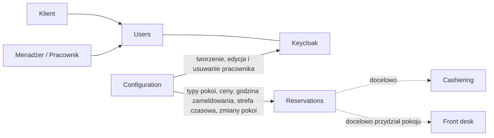
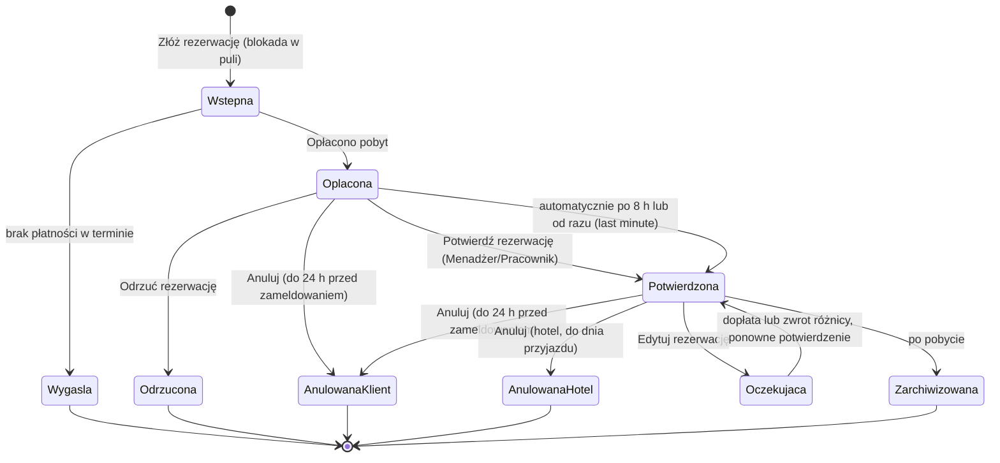

# PSuite – model domeny (v4)

System zarządzania hotelem. Dokument opisuje cały system: wszystkie obszary tablicy Event Stormingu oraz decyzje zespołu.

- Tablica: Miro „PSuite”, https://miro.com/app/board/uXjVNhxQEqg=/ (234 elementy: główna oś czasu i cztery obszary kontekstów)
- Decyzje zespołu: 13.11.2026

## Oznaczenia i zasady pierwszeństwa

- **[Decyzja]** – ustalone przez zespół. Wiążące.
- **[Tablica]** – zapisane na tablicy. Wiążące, o ile decyzja nie mówi inaczej.
- **[Wniosek]** – interpretacja lub propozycja projektowa. Do potwierdzenia przed implementacją.
- **[Otwarte]** – nierozstrzygnięte. Nie implementować na własną rękę.
- **[Hot spot]** – otwarte pytanie zapisane na tablicy czerwoną karteczką. Traktowane jak [Otwarte].
- **[Kod]** – dotyczy modułu już zrealizowanego. Sprawdź w kodzie, jak zostało rozwiązane.

Pierwszeństwo: Decyzja > Tablica > Wniosek.
Dla modułów zrealizowanych (Configuration, Users) źródłem prawdy jest kod. Jeśli kod różni się od tego dokumentu, aktualizujemy dokument.

---

## 1. Kontekst projektu

[Decyzja] **PoC: modularny monolit rozwijany z udziałem agentów.** Zasada nadrzędna: najprostsze rozwiązanie, które spełnia decyzje z tego dokumentu. Bez kolejek, sag, event sourcingu i konfigurowalności „na zapas”. Elementy oznaczone jako „docelowo” lub „poza zakresem PoC” nie są implementowane.

[Decyzja] Front desk (w tym przydział konkretnego pokoju gościowi) zostanie dodany później. Do tego czasu rezerwacje dotyczą typu pokoju, nie konkretnego numeru.

---

## 2. Jak czytać tablicę

Tablica ma dwie warstwy:

1. **Główna oś czasu** (etykieta „CZAS”, czytana od lewej do prawej) – pierwotny, chronologiczny przebieg procesu.
2. **Obszary kontekstów** poniżej osi: Reservations / Stay, Configuration (hotel, room, staff) z podobszarem KEYCLOAK, Cashiering, Users. Zawierają te same zdarzenia, przegrupowane według kontekstu.

Legenda [Tablica]: Domain Event, Actor, Command, Policy, Hot spot, External system, Aggregate, Read model, Opportunity.
Aggregate, Read model i Opportunity nie zostały użyte w przepływach – warsztat nie doszedł do modelowania agregatów. Wszystkie agregaty w tym dokumencie to [Wniosek].

---

## 3. Zakres systemu

| Kontekst | Stan projektu | Stan na tablicy | Odpowiedzialność |
|---|---|---|---|
| Configuration (hotel, room, staff) | **zrealizowany**, wymaga rozszerzenia (5.5) | wypełniony | hotele, typy pokoi, pokoje, pracownicy, integracja z Keycloak |
| Users | **zrealizowany** (Keycloak) | wypełniony | rejestracja klienta, logowanie, edycja danych użytkownika |
| Reservations / Stay | **następny do realizacji** | wypełniony | dostępność, wycena, rezerwacja, płatność, potwierdzenie, anulowanie, edycja, reklamacje, oceny |
| Cashiering | poza zakresem PoC | **pusty** | docelowo płatności i zwroty |
| House keeping | poza zakresem PoC | brak (notatka „na przyszłość”) | – |
| Front desk | poza zakresem PoC | brak (notatka „na przyszłość”) | docelowo m.in. przydział pokoju |

### 3.1 Zależności między kontekstami



[Wniosek] Moduły komunikują się przez publiczne API (odczyty) i zdarzenia obsługiwane w tym samym procesie (zmiany). Żaden moduł nie czyta tabel innego modułu.

---

## 4. Aktorzy

| Aktor | Konteksty | Uwagi |
|---|---|---|
| Klient | Users, Reservations | rejestruje się, rezerwuje, płaci, anuluje, edytuje, reklamuje, ocenia |
| Menadżer hotelu | Configuration, Users, Reservations | konfiguruje hotel, typy pokoi, pokoje i personel; obsługuje rezerwacje i reklamacje |
| Pracownik hotelu | Users, Reservations | obsługuje rezerwacje i reklamacje |
| system | Reservations | wygaśnięcie, automatyczne potwierdzenie, przypomnienia, archiwizacja |
| Keycloak | Configuration, Users | system zewnętrzny: tożsamość i konta |

[Hot spot] „Gość?” – czy osoba przebywająca w hotelu to osobna rola niż Klient, który rezerwuje.
[Hot spot] „Zdefiniować role pracowników hotelu.” [Kod]
[Hot spot] „Czy można stworzyć drugiego menadżera?” [Kod]

### 4.1 Uprawnienia

[Wniosek] Model złożony z aktorów przypisanych do komend na tablicy. Menadżer = Pracownik + konfiguracja.

| Działanie | Klient | Pracownik | Menadżer |
|---|---|---|---|
| Rejestracja | tak | – | – |
| Logowanie, edycja własnych danych | tak | tak | tak |
| Konfiguracja hotelu, typów pokoi, pokoi | – | – | tak |
| Zarządzanie pracownikami | – | – | tak |
| Wycena, rezerwacja, płatność | tak | – | – |
| Anulowanie i edycja własnej rezerwacji, reklamacja, ocena | tak | – | – |
| Potwierdzenie i odrzucenie rezerwacji | – | tak | tak |
| Anulowanie rezerwacji przez hotel | – | tak | tak |
| Rozpatrzenie reklamacji | – | tak | tak |
| Podgląd przepełnionych nocy (7.2.5) | – | [Otwarte] | tak |

---

## 5. Kontekst: Configuration (hotel, room, staff)

[Kod] Moduł zrealizowany. Sekcje 5.1–5.4 opisują go według tablicy. Sekcja 5.5 to rozszerzenie wymagane przed rezerwacjami.

### 5.1 Hotel

| Aktor | Komenda | Zdarzenie |
|---|---|---|
| Menadżer hotelu | Stwórz hotel | Stworzono hotel |
| Menadżer hotelu | Edytuj hotel | Edytowano hotel |
| Menadżer hotelu | Usuń hotel | Usunięto hotel |

[Otwarte] Co z rezerwacjami, gdy hotel zostaje usunięty? Tablica tego nie łączy. [Wniosek] W PoC najprościej zablokować usunięcie hotelu, który ma aktywne rezerwacje.

### 5.2 Pokoje

| Aktor | Komenda | Zdarzenie |
|---|---|---|
| Menadżer hotelu | Stwórz pokój | Stworzono pokój |
| Menadżer hotelu | Edytuj pokój | Edytowano informację o pokoju |

[Tablica] Brak usuwania pokoju. [Wniosek] W PoC wyłączenie pokoju z użytku (flaga „aktywny”, 5.5) zastępuje usuwanie.

### 5.3 Pracownicy

| Aktor | Komenda | Zdarzenie (jak na tablicy) | Proponowana nazwa | System zewnętrzny |
|---|---|---|---|---|
| Menadżer hotelu | Stwórz pracownika | Utworzono pracownika | Utworzono pracownika | Keycloak REST Calls |
| Menadżer hotelu | Edytuj pracownika | „Edytuj pracownika” ⚠ | Edytowano pracownika | Keycloak REST Calls |
| Menadżer hotelu | Usuń pracownika | „Edytuj pracownika” ⚠ | Usunięto pracownika | Keycloak REST Calls |

⚠ Na tablicy zdarzenia zapisano w trybie rozkazującym, a przy usuwaniu nazwa jest skopiowana z edycji.
Na głównej osi czasu to samo zdarzenie tworzenia nazywa się „Utworzono konto pracownika hotelu”.

### 5.4 Integracja z Keycloak

[Tablica] Tworzenie pracownika:

1. Stworzenie pracownika przez Configuration API.
2. Wywołania REST do Keycloak API: `createUser`, `executeActionsEmail`.

[Tablica] Obszar KEYCLOAK, połączony strzałkami z „Keycloak REST Calls” przy tworzeniu pracownika:

| Komenda | Zdarzenie |
|---|---|
| Utwórz użytkownika | Utworzono użytkownika |
| Wyślij email z prośbą o ustawienie hasła | Wysłano email z prośbą o ustawienie hasła |

[Kod] Tablica nie pokazuje, które wywołania Keycloak obsługują edycję i usuwanie pracownika (aktualizacja, dezaktywacja czy usunięcie konta), ani co się dzieje, gdy zapis w PSuite się uda, a wywołanie Keycloak nie.

### 5.5 Rozszerzenie wymagane przez Reservations (PoC)

[Wniosek] Moduł Configuration nie ma danych potrzebnych rezerwacjom (stan na 13.11.2026). Poniżej najmniejszy zakres, który je odblokowuje. Nic ponad to.

**Typ pokoju (nowy byt)**

| Pole | Opis |
|---|---|
| hotel | typ należy do jednego hotelu |
| nazwa | np. „Dwuosobowy standard” |
| cena za noc | z podatkami i opłatami [D14]; w PoC jedna waluta (np. PLN) |

| Aktor | Komenda | Zdarzenie |
|---|---|---|
| Menadżer hotelu | Stwórz typ pokoju | Stworzono typ pokoju |
| Menadżer hotelu | Edytuj typ pokoju (nazwa, cena) | Edytowano typ pokoju |

Zmiana ceny dotyczy tylko nowych rezerwacji, bo cena jest zamrażana przy złożeniu [D14]. Usuwanie typów pokoi – poza zakresem PoC.
Na tablicy cenę reprezentuje zdarzenie „Zdefiniowano bazową wycenę”, nieprzypisane do żadnego obszaru.

**Pokój (rozszerzenie)**

| Pole | Opis |
|---|---|
| typ pokoju | wymagany; decyduje, do której puli należy pokój |
| aktywny | pokój nieaktywny nie liczy się do pojemności puli [D13] |

**Hotel (rozszerzenie)**

| Pole | Opis |
|---|---|
| godzina zameldowania | np. 15:00; z datą przyjazdu wyznacza moment zameldowania [D7] |
| strefa czasowa | identyfikator IANA, np. `Europe/Warsaw` |

Godzina wymeldowania nie jest potrzebna do żadnej obecnej reguły – poza zakresem PoC.

**Kontrakt z Reservations**

- Reservations odczytuje cenę za noc, godzinę zameldowania i strefę czasową przez publiczne API Configuration.
- Zdarzenia, na które Reservations reaguje, aktualizując pojemność puli: Stworzono pokój, Edytowano informację o pokoju (zmiana typu lub aktywności). W PoC obsługa w tym samym procesie, bez kolejki.

[Decyzja D15] Istniejące pokoje bez typu: **reset danych testowych.** Dane zakładamy od nowa, już z typami pokoi. Bez migracji z typem domyślnym.

---

## 6. Kontekst: Users

[Kod] Moduł zrealizowany na Keycloak.

| Aktor | Komenda | Zdarzenie |
|---|---|---|
| Klient | Zarejestruj się | Utworzono konto klienta |
| Klient, Pracownik hotelu, Menadżer hotelu | Zaloguj | Zalogowano się do systemu |
| Klient, Pracownik hotelu, Menadżer hotelu | Edytuj informacje | Edytowano informacje użytkownika |

⚠ Na głównej osi czasu przed „Utworzono konto klienta” stoi komenda „Stwórz konto pracownika” z aktorem Klient. W obszarze Users ta sama para ma poprawną komendę „Zarejestruj się”. To błąd kopiowania na osi czasu.

[Wniosek] Konta pracowników powstają w Configuration (zakłada je menadżer), konta klientów w Users (samodzielna rejestracja). [Kod] Tablica pokazuje integrację z Keycloak tylko dla pracowników.

---

## 7. Kontekst: Reservations / Stay

### 7.1 Decyzje

| # | Temat | Decyzja |
|---|---|---|
| D1 | Potwierdzenie | Rezerwację potwierdza Menadżer hotelu lub Pracownik hotelu. |
| D2 | Kolejność | Płatność następuje przed potwierdzeniem. |
| D3 | Wygaśnięcie | Nieopłacona rezerwacja wygasa po 15 minutach. |
| D4 | Dostępność | Model puli pokoi danego typu. Klient rezerwuje typ pokoju, konkretny pokój przydziela Front desk (później). |
| D5 | Anulowanie przez klienta | Klient nie może anulować później niż 24 godziny przed momentem zameldowania. |
| D6 | Zwrot przy anulowaniu przez klienta | Pełny zwrot przy anulowaniu najpóźniej 24 godziny przed momentem zameldowania. |
| D7 | „Dzień przed” | 24 godziny przed momentem zameldowania (data przyjazdu + godzina zameldowania hotelu). |
| D8 | Polityki docelowo | Każdy hotel będzie mógł definiować własne polityki anulowania i zwrotu (poza zakresem PoC). |
| D9 | Automatyczne potwierdzenie | Opłacona rezerwacja bez decyzji hotelu przez 8 godzin od opłacenia potwierdza się automatycznie. |
| D10 | Rezerwacja last minute | Jeśli od opłacenia do momentu zameldowania zostaje mniej niż 8 godzin, rezerwacja potwierdza się od razu po opłaceniu. |
| D11 | Płatność a wygaśnięcie | Rozpoczęcie płatności przedłuża blokadę jednorazowo o 15 minut. Płatność potwierdzona po przedłużonym terminie – poza zakresem PoC. |
| D12 | Rezygnacja hotelu | Odrzucenie i anulowanie przez hotel zawsze dają pełny zwrot. Hotel może anulować najpóźniej do dnia przyjazdu. Docelowo: anulowanie z powodu złamania regulaminu przez klienta bez zwrotu (poza zakresem PoC). |
| D13 | Spadek pojemności | Zmiana w Configuration zawsze przechodzi. Noce z większą liczbą zajętych miejsc niż pojemność są oznaczane jako przepełnione, menadżer rozwiązuje to ręcznie. |
| D14 | Wycena | Cena za typ pokoju i noc × liczba nocy, z podatkami i opłatami. Zamrażana przy złożeniu rezerwacji, ważna do jej wygaśnięcia. Bez zależności od liczby osób i bez promocji. |
| D16 | Last minute a rezygnacja hotelu | Rezerwacji last minute (D10) hotel nie może odrzucić. Może ją tylko anulować z pełnym zwrotem, najpóźniej do dnia przyjazdu (D12). |

D15 dotyczy modułu Configuration – patrz 5.5.

[Wniosek] D5, D6 i D12 oznaczają, że w PoC każdy zwrot przy anulowaniu lub odrzuceniu jest pełny. Otwarta zostaje tylko kwota przy reklamacjach (7.9).

### 7.2 Dostępność: pula pokoi danego typu

#### 7.2.1 Pojęcia

- **Pojemność** – liczba aktywnych pokoi danego typu w hotelu.
- **Noc** – jednostka dostępności. Pobyt od 10 do 13 listopada zajmuje noce 10, 11 i 12.
- **Blokada** – zajęcie jednego miejsca w puli danego typu na każdą noc pobytu, powiązane z jedną rezerwacją.

#### 7.2.2 Niezmiennik

Dla każdego hotelu, typu pokoju i nocy: `liczba aktywnych blokad <= pojemność`.

Aktywna blokada to blokada rezerwacji w stanie Wstępna (niewygasła), Opłacona, Potwierdzona lub Oczekująca.

#### 7.2.3 Egzekwowanie

[Wniosek] Odczyt rezerwacji i sprawdzenie „czy jest miejsce” nie chroni przed podwójną rezerwacją przy równoczesnych zapytaniach. Konflikt musi wykrywać zapis.

Struktura: wiersz inwentarza na (hotel, typ pokoju, noc) z polami `pojemność` i `zajęte`. Założenie blokady to w jednej transakcji, dla każdej nocy pobytu:

```
UPDATE inwentarz
SET zajete = zajete + 1
WHERE hotel = :hotel AND typ_pokoju = :typ AND noc = :noc
  AND zajete < pojemnosc
```

Jeśli którakolwiek noc zwróci 0 zmienionych wierszy, transakcja jest wycofywana i klient dostaje informację o braku dostępności. Zwolnienie blokady zmniejsza `zajęte` dla tych samych nocy. To szkic mechanizmu, nie wymóg technologii.

#### 7.2.4 Wyszukiwanie wolnych pokoi

[Wniosek] Wyszukiwanie (ile pokoi danego typu jest wolnych w terminie) korzysta z read modelu zbudowanego z inwentarza. Wynik jest podpowiedzią, rozstrzyga zapis blokady z 7.2.3.

#### 7.2.5 Zmiana pojemności

Gdy przybywa aktywny pokój danego typu, pojemność rośnie. Gdy pokój zmienia typ lub zostaje wyłączony, maleje.

[Decyzja D13] Spadek pojemności poniżej liczby zajętych miejsc nie blokuje zmiany w Configuration. Takie noce są oznaczane jako przepełnione, menadżer rozwiązuje to ręcznie (np. anulowaniem przez hotel z pełnym zwrotem, D12).

[Wniosek] Konsekwencje techniczne:

- w bazie nie ma ograniczenia `zajęte <= pojemność`, bo D13 dopuszcza jego złamanie,
- warunek `zajete < pojemnosc` z 7.2.3 blokuje nowe rezerwacje w przepełnionych nocach,
- w PoC „powiadomienie” to lista przepełnionych nocy widoczna dla menadżera, bez wysyłki e-maili.

#### 7.2.6 Mała liczba wolnych pokoi

[Tablica] Zdarzenie „Wysłano informację o małej liczbie pokoi” (na osi czasu, bez obszaru i aktora).
[Wniosek] Polityka po założeniu blokady: gdy liczba wolnych miejsc danego typu w którejś nocy spada poniżej progu, menadżer dostaje powiadomienie.
[Otwarte] Wartość progu.

### 7.3 Wycena

| Aktor | Komenda | Zdarzenie | Polityka |
|---|---|---|---|
| Klient | Pobierz wycenę pobytu (hotel, typ pokoju, daty) | Wyceniono pobyt | pricing policy |

[Decyzja D14]

```
cena_pobytu = cena_za_noc(typ_pokoju) × liczba_nocy
```

- cena zawiera podatki i opłaty, nie zależy od liczby osób,
- bez promocji („Nadano promocje” z tablicy – poza zakresem PoC),
- zamrażana przy złożeniu rezerwacji, ważna do jej wygaśnięcia (15 min, ewentualnie przedłużone przez D11).

### 7.4 Złożenie, płatność i wygaśnięcie

| Krok | Aktor | Komenda | Zdarzenia | Reguły |
|---|---|---|---|---|
| 1 | Klient | Złóż rezerwację | Zabookowano pokój (wstępna rezerwacja), Wysłano prośbę o rezerwację | zakłada blokadę (7.2.3); wygasa po 15 min [D3] |
| 2 | Klient | Rozpocznij płatność | Rozpoczęto płatność | przedłuża blokadę jednorazowo o 15 min [D11] |
| 3 | Klient | Opłać pobyt | Opłacono pobyt | przed potwierdzeniem [D2]; blokada przestaje wygasać |
| – | system | – | Rezerwacja wygasła, Odblokowano pokój | brak płatności w terminie [D3, D11] |
| – | system | – | Przypomniano o zapłacie | [Otwarte] kiedy, przy 15-minutowym oknie |

[Tablica] Hot spot „Saga?” przy płatności – odpowiedź w sekcji 8.

### 7.5 Potwierdzenie i odrzucenie

| Aktor | Komenda | Zdarzenia | Reguły |
|---|---|---|---|
| Menadżer lub Pracownik | Potwierdź rezerwację | Potwierdzono rezerwację | tylko rezerwacja opłacona [D1, D2] |
| system | – | Potwierdzono rezerwację (automatycznie) | brak decyzji hotelu przez 8 h od opłacenia [D9] |
| system | – | Potwierdzono rezerwację (automatycznie) | od razu po opłaceniu, gdy do zameldowania zostaje mniej niż 8 h [D10] |
| Menadżer lub Pracownik | Odrzuć rezerwację | Odrzucono rezerwację, Odblokowano pokój, Zwrócono pieniądze za pobyt | tylko przed potwierdzeniem; pełny zwrot [D12] |

```
moment_zameldowania = data_przyjazdu + godzina_zameldowania_hotelu (strefa czasowa hotelu)
jeśli moment_opłacenia + 8 h >= moment_zameldowania:
    potwierdź od razu
w przeciwnym razie:
    czekaj na decyzję hotelu, najdłużej 8 h od opłacenia
```

[Decyzja D16] Po potwierdzeniu (ręcznym lub automatycznym) hotel nie może już odrzucić rezerwacji, może ją tylko anulować (7.7). Dotyczy to także rezerwacji last minute, których hotel w ogóle nie odrzuci.

### 7.6 Anulowanie przez klienta

| Aktor | Komenda | Zdarzenia | Reguły |
|---|---|---|---|
| Klient | Anuluj rezerwację | Anulowano rezerwację - klient, Odblokowano pokój, Zwrócono pieniądze za pobyt | tylko gdy teraz < moment zameldowania − 24 h [D5, D7]; pełny zwrot [D6] |

[Wniosek] Klient może anulować rezerwację opłaconą, także jeszcze niepotwierdzoną, na tych samych zasadach.

### 7.7 Anulowanie przez hotel

| Aktor | Komenda | Zdarzenia | Reguły |
|---|---|---|---|
| Menadżer lub Pracownik | Anuluj rezerwację | Anulowano rezerwację - hotel, Odblokowano pokój, Zwrócono pieniądze za pobyt | najpóźniej do dnia przyjazdu; pełny zwrot [D12] |

[Wniosek] „Do dnia przyjazdu” rozumiemy jako do momentu zameldowania. Do poprawy, jeśli granicą ma być koniec dnia poprzedzającego przyjazd.

[Wniosek] Tablica nie pokazuje „Odblokowano pokój” przy anulowaniach, ale w modelu puli zwolnienie blokady jest konieczne przy każdym zakończeniu rezerwacji innym niż pobyt.

### 7.8 Edycja rezerwacji

| Aktor | Komenda | Zdarzenia |
|---|---|---|
| Klient | Edytuj rezerwację | Edytowano rezerwację, Zmieniono termin rezerwacji, Zmieniono wycenę pobytu, Zmieniono status rezerwacji na oczekujący |

[Tablica] Dalej: dopłata (Wysłano prośbę o opłatę → Opłać pobyt → Opłacono pobyt) albo zwrot różnicy (Zwrócono pieniądze za pobyt, Refund policy), potem ponowne potwierdzenie.

[Wniosek] Przy zmianie terminu nowe blokady trzeba założyć, zanim zwolni się stare, w jednej transakcji. Inaczej klient straci dotychczasową rezerwację, gdy nowego terminu nie ma.

[Hot spot] „Można edytować w trakcie trwania pobytu” – założenie, nie przyjęta reguła.
[Hot spot] „Policy?” przy przejściu do stanu oczekującego – brakująca reguła.
[Otwarte] Czy edycja podlega progowi 24 h, czy można zmienić typ pokoju, jakie jest okno na dopłatę.

### 7.9 Reklamacje

| Aktor | Komenda | Zdarzenia |
|---|---|---|
| Klient | Złóż reklamację | Złożono reklamację |
| Menadżer lub Pracownik | Zaakceptuj reklamację | Zaakceptowano reklamację, Zwrócono pieniądze za pobyt |
| Menadżer lub Pracownik | Odrzuć reklamację | Odrzucono reklamację |

[Otwarte] Kwota zwrotu przy reklamacji (pełna czy częściowa) i od kiedy można ją złożyć.

### 7.10 Ocena pobytu

| Aktor | Komenda | Zdarzenie |
|---|---|---|
| Klient | Oceń pobyt | Oceniono pobyt |

[Otwarte] Kiedy można ocenić pobyt i czy jedna ocena na rezerwację.

### 7.11 Archiwizacja

| Aktor | Komenda | Zdarzenie |
|---|---|---|
| system | – | Zarchiwizowano rezerwację |

[Tablica] Zdarzenie na końcu osi czasu, bez komendy, aktora i obszaru.
[Otwarte] Co wyzwala archiwizację i kiedy.

### 7.12 Cykl życia rezerwacji

[Wniosek] Model zbudowany z tablicy i decyzji D1–D16.



Każde przejście do stanu końcowego innego niż Zarchiwizowana zwalnia blokadę w puli. Każde takie przejście po opłaceniu wywołuje pełny zwrot.

---

## 8. Kontekst: Cashiering

[Tablica] Obszar wyznaczony, ale pusty. Notatka „Dodatkowe opcje w przyszłości” wymienia Cashiering (płatności).

[Wniosek] W PoC płatności i zwroty żyją w module Reservations.

[Wniosek] Odpowiedź na hot spot „Saga?”: **w PoC saga nie jest potrzebna.** Inwentarz, Rezerwacja i Płatność są w jednym module i jednej bazie, więc blokada, zmiana stanu rezerwacji i zwolnienie blokady dzieją się w jednej transakcji. Terminy (15 min, przedłużenie z D11, 8 h) obsługuje jedno zadanie cykliczne sprawdzające co minutę przeterminowane rezerwacje. Wywołania zewnętrznego operatora płatności, które mogą się nie udać (np. zwrot), zapisujemy jako „do wykonania” w tej samej transakcji i ponawiamy w tym samym zadaniu cyklicznym. Sagę warto rozważyć, gdy płatności przejdą do osobnego kontekstu Cashiering z własną bazą.

---

## 9. Zdarzenia spoza obszarów tablicy

[Tablica] Cztery zdarzenia są na osi czasu, ale nie trafiły do żadnego obszaru i nie mają komendy ani aktora. Miejsce w tym modelu:

| Zdarzenie | Miejsce |
|---|---|
| Zdefiniowano bazową wycenę | Configuration – cena za noc typu pokoju (5.5) |
| Nadano promocje | poza zakresem PoC (D14) |
| Wysłano informację o małej liczbie pokoi | Reservations – dostępność (7.2.6) |
| Zarchiwizowano rezerwację | Reservations – proces automatyczny (7.11) |

---

## 10. Polityki

| Polityka | Gdzie działa | Reguła w PoC | Docelowo |
|---|---|---|---|
| Pricing policy | wycena (7.3) | cena za noc typu × liczba nocy, z podatkami, zamrożona przy złożeniu [D14] | zależność od liczby osób, promocje |
| Cancellation policy | anulowanie przez klienta (7.6) | najpóźniej 24 h przed momentem zameldowania [D5, D7] | per hotel [D8] |
| Refund policy | odrzucenie, anulowania, reklamacja, edycja | pełny zwrot przy anulowaniu przez klienta w terminie [D6] oraz przy odrzuceniu i anulowaniu przez hotel [D12]; reklamacje [Otwarte] | per hotel [D8]; bez zwrotu przy złamaniu regulaminu |
| Anulowanie przez hotel | 7.7 | najpóźniej do dnia przyjazdu [D12] | – |
| Wygaśnięcie | 7.4 | 15 min, przedłużane raz o 15 min przy rozpoczęciu płatności [D3, D11] | – |
| Automatyczne potwierdzenie | 7.5 | po 8 h od opłacenia albo od razu dla last minute [D9, D10] | – |
| Mała liczba pokoi | 7.2.6 | próg [Otwarte] | – |
| „Policy?” (edycja) | 7.8 | [Hot spot] brak | – |

Reguła anulowania przez klienta:

```
moment_zameldowania = data_przyjazdu + godzina_zameldowania_hotelu (strefa czasowa hotelu)
klient może anulować, jeśli teraz < moment_zameldowania - 24 godziny
```

[Wniosek] W PoC każda polityka to jedno miejsce w kodzie ze stałymi wartościami (24 h, 100%, 15 min, 8 h), bez zapisu w bazie. Dzięki temu D8 da się dodać później bez przebudowy.

---

## 11. Agregaty

[Wniosek] Tablica nie zawiera agregatów. Propozycja wynika z tego, które zdarzenia muszą być spójne razem.

| Agregat | Kontekst | Zdarzenia | Granica spójności |
|---|---|---|---|
| Hotel | Configuration | Stworzono / Edytowano / Usunięto hotel | dane hotelu, w tym godzina zameldowania i strefa czasowa |
| Typ pokoju | Configuration | Stworzono / Edytowano typ pokoju | nazwa, cena za noc |
| Pokój | Configuration | Stworzono pokój, Edytowano informację o pokoju | typ, aktywność |
| Pracownik | Configuration | Utworzono / Edytowano / Usunięto pracownika | zsynchronizowany z Keycloak [Kod] |
| Konto użytkownika | Users (Keycloak) | Utworzono konto klienta, Zalogowano się, Edytowano informacje użytkownika | zarządzane przez Keycloak [Kod] |
| Inwentarz typu pokoju (hotel, typ, noc) | Reservations | Zabookowano pokój, Odblokowano pokój, Wysłano informację o małej liczbie pokoi | niezmiennik z 7.2.2 |
| Rezerwacja | Reservations | wygaśnięcie, potwierdzenie, odrzucenie, anulowania, edycja, archiwizacja | cykl życia z 7.12, zamrożona cena |
| Płatność | Reservations (docelowo Cashiering) | Rozpoczęto płatność, Opłacono pobyt, Zwrócono pieniądze za pobyt, Przypomniano o zapłacie | stan płatności i zwrotów |
| Reklamacja | Reservations | Złożono / Zaakceptowano / Odrzucono reklamację | stan reklamacji |
| Ocena | Reservations | Oceniono pobyt | jedna ocena na rezerwację [Otwarte] |

Polityki nie są agregatem – w PoC to kod ze stałymi (sekcja 10).

---

## 12. Katalog zdarzeń (nazwy docelowe)

Poprawione literówki i formy z tablicy. „Nowe” oznacza zdarzenie, którego nie ma na tablicy.

| Zdarzenie | Kontekst | Pochodzenie |
|---|---|---|
| Stworzono hotel | Configuration | tablica |
| Edytowano hotel | Configuration | tablica |
| Usunięto hotel | Configuration | tablica |
| Stworzono typ pokoju | Configuration | **nowe** (5.5) |
| Edytowano typ pokoju | Configuration | **nowe** (5.5) |
| Stworzono pokój | Configuration | tablica |
| Edytowano informację o pokoju | Configuration | tablica |
| Utworzono pracownika | Configuration | tablica (na osi czasu: „Utworzono konto pracownika hotelu”) |
| Edytowano pracownika | Configuration | tablica („Edytuj pracownika”) |
| Usunięto pracownika | Configuration | tablica (błędnie „Edytuj pracownika”) |
| Utworzono użytkownika | Configuration → Keycloak | tablica |
| Wysłano email z prośbą o ustawienie hasła | Configuration → Keycloak | tablica |
| Utworzono konto klienta | Users | tablica |
| Zalogowano się do systemu | Users | tablica |
| Edytowano informacje użytkownika | Users | tablica |
| Wyceniono pobyt | Reservations | tablica |
| Zabookowano pokój (wstępna rezerwacja) | Reservations | tablica („Zabookwano”); oznacza blokadę w puli |
| Wysłano prośbę o rezerwację | Reservations | tablica |
| Rozpoczęto płatność | Reservations | **nowe** (D11) |
| Opłacono pobyt | Reservations | tablica |
| Rezerwacja wygasła | Reservations | **nowe** (D3) |
| Przypomniano o zapłacie | Reservations | tablica |
| Potwierdzono rezerwację | Reservations | tablica; także automatycznie (D9, D10) |
| Odrzucono rezerwację | Reservations | tablica |
| Odblokowano pokój | Reservations | tablica; oznacza zwolnienie blokady w puli |
| Anulowano rezerwację - klient | Reservations | tablica („- user”) |
| Anulowano rezerwację - hotel | Reservations | tablica („rezerwajce”) |
| Zwrócono pieniądze za pobyt | Reservations | tablica |
| Edytowano rezerwację | Reservations | tablica |
| Zmieniono termin rezerwacji | Reservations | tablica |
| Zmieniono wycenę pobytu | Reservations | tablica („Zmiana wyceny pobytu”) |
| Zmieniono status rezerwacji na oczekujący | Reservations | tablica („Zmiana statusu rezerwacji (oczekujące)”) |
| Wysłano prośbę o opłatę | Reservations | tablica |
| Złożono reklamację | Reservations | tablica („reklamacje”) |
| Zaakceptowano reklamację | Reservations | tablica („reklamacje”) |
| Odrzucono reklamację | Reservations | tablica |
| Oceniono pobyt | Reservations | tablica |
| Zarchiwizowano rezerwację | Reservations | tablica |
| Wysłano informację o małej liczbie pokoi | Reservations | tablica |
| Zdefiniowano bazową wycenę | Configuration | tablica; realizowane jako cena za noc typu pokoju |
| Nadano promocje | – | tablica; poza zakresem PoC |

---

## 13. Otwarte pytania

### Blokujące przed implementacją rezerwacji

Brak (stan na 13.11.2026). Można zaczynać od zadania 1 z sekcji 16.

### Do rozstrzygnięcia później

Każde z tych pytań blokuje dopiero zadanie, którego dotyczy.

1. Zasady edycji rezerwacji: próg 24 h, zmiana typu pokoju, okno na dopłatę, edycja w trakcie pobytu, brakująca „Policy?” (7.8) – przed zadaniem 6.
2. Kiedy wysyłać przypomnienie o zapłacie przy 15-minutowym oknie (7.4) – przed zadaniem 3, jeśli przypomnienie ma być w PoC.
3. Próg powiadomienia o małej liczbie pokoi (7.2.6) – przed zadaniem 2, jeśli powiadomienie ma być w PoC.
4. Kwota zwrotu przy reklamacji i od kiedy można ją złożyć (7.9) – przed zadaniem 6.
5. Warunki oceny pobytu i wyzwalacz archiwizacji (7.10, 7.11) – przed zadaniem 6.
6. Co z rezerwacjami przy usunięciu hotelu (5.1) – przed zadaniem 3.
7. Czy Pracownik widzi przepełnione noce (4.1) – przed zadaniem 2.
8. Czy potrzebna jest rola Gościa obok Klienta (hot spot).

### Do sprawdzenia w kodzie (moduły zrealizowane)

- Role pracowników hotelu i możliwość drugiego menadżera (hot spoty).
- Wywołania Keycloak przy edycji i usuwaniu pracownika; obsługa błędu, gdy zapis w PSuite się uda, a Keycloak nie (5.4).
- Czy konta klientów trafiają do Keycloak (6).

### Poza zakresem PoC

- Płatność potwierdzona po przedłużonym terminie blokady (D11).
- Anulowanie przez hotel bez zwrotu przy złamaniu regulaminu (D12).
- Cena zależna od liczby osób, promocje (D14).
- Polityki definiowane per hotel i ich wersjonowanie (D8).
- Historia wycen i faktura obejmująca wiele wycen (hot spot).
- Usuwanie typów pokoi, godzina wymeldowania (5.5).
- Cashiering, House keeping, Front desk (przydział konkretnego pokoju).

---

## 14. Błędy i niespójności na tablicy

| # | Miejsce | Problem | Poprawka w tym dokumencie |
|---|---|---|---|
| 1 | Configuration, edycja pracownika | zdarzenie „Edytuj pracownika” w trybie rozkazującym | Edytowano pracownika |
| 2 | Configuration, usuwanie pracownika | zdarzenie skopiowane z edycji | Usunięto pracownika |
| 3 | Oś czasu vs Configuration | „Utworzono konto pracownika hotelu” vs „Utworzono pracownika” | Utworzono pracownika |
| 4 | Oś czasu, rejestracja klienta | komenda „Stwórz konto pracownika” przy aktorze Klient | Zarejestruj się |
| 5 | Edycja rezerwacji | komenda „Potwierdzono rezerwaje” ma formę zdarzenia i literówkę | Potwierdź rezerwację |
| 6 | Wiele miejsc | literówki: „Zabookwano”, „rezerwajce”, „menegera”, „reklamacje” w zdarzeniach | poprawione w katalogu (12) |
| 7 | Anulowania | brak „Odblokowano pokój” po anulowaniu przez klienta i hotel | dodane (7.6, 7.7) |
| 8 | Cashiering | pusty obszar | płatności w Reservations (8) |
| 9 | Oś czasu | 4 zdarzenia bez obszaru | przypisane (9) |

---

## 15. Słownik pojęć

- **Typ pokoju** – kategoria pokoi z jedną ceną za noc; jednostka rezerwacji.
- **Pula** – wszystkie aktywne pokoje danego typu w hotelu; jej wielkość to pojemność.
- **Blokada** – zajęcie miejsca w puli na każdą noc pobytu przez jedną rezerwację.
- **Przepełniona noc** – noc, w której zajętych miejsc jest więcej niż pojemność (D13).
- **Moment zameldowania** – data przyjazdu + godzina zameldowania hotelu, w strefie czasowej hotelu.
- **Rezerwacja wstępna** – stan po złożeniu, przed opłaceniem; wygasa po 15 min (D3, D11).
- **Rezerwacja last minute** – opłacona, gdy do zameldowania zostaje mniej niż 8 h (D10).
- **Wycena** – cena pobytu wg pricing policy, zamrażana przy złożeniu rezerwacji.
- **Reklamacja** – zgłoszenie klienta rozpatrywane przez pracownika lub menadżera.

---

## 16. Jak używać tego dokumentu z agentem

- Plik leży w repo jako `docs/domain.md`. W `CLAUDE.md`:

  > Model domeny: docs/domain.md. [Decyzja] i [Tablica] są wiążące. [Wniosek] wymaga potwierdzenia. [Otwarte] – nie implementuj, zapytaj. Dla modułów zrealizowanych źródłem prawdy jest kod. Projekt to PoC na modularnym monolicie – wybieraj najprostsze rozwiązanie, nie implementuj niczego spoza zakresu PoC.

- Kolejność zadań przez `/poteto-mode`:
  1. Rozszerzenie Configuration zgodnie z 5.5.
  2. Inwentarz typu pokoju i niezmiennik z 7.2.2, z testem równoczesnych rezerwacji ostatniego wolnego miejsca.
  3. Złożenie rezerwacji, płatność, wygaśnięcie (7.4).
  4. Potwierdzenie, odrzucenie i automatyczne potwierdzenie (7.5).
  5. Anulowanie przez klienta i hotel (7.6, 7.7, 10).
  6. Reklamacje, ocena, edycja, archiwizacja – po rozstrzygnięciu pytań z sekcji 13.
- Przykładowy prompt: `/poteto-mode rozszerz moduł Configuration zgodnie z docs/domain.md, sekcja 5.5. Weryfikacja: menadżer tworzy typ pokoju z ceną, przypisuje do niego pokój, ustawia godzinę zameldowania i strefę czasową hotelu, a publiczne API modułu zwraca te dane.`
- Po każdej nowej decyzji zespołu dopisz ją do sekcji 7.1 (albo odpowiedniej sekcji kontekstu) i usuń z sekcji 13.
